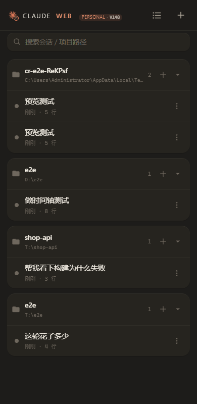
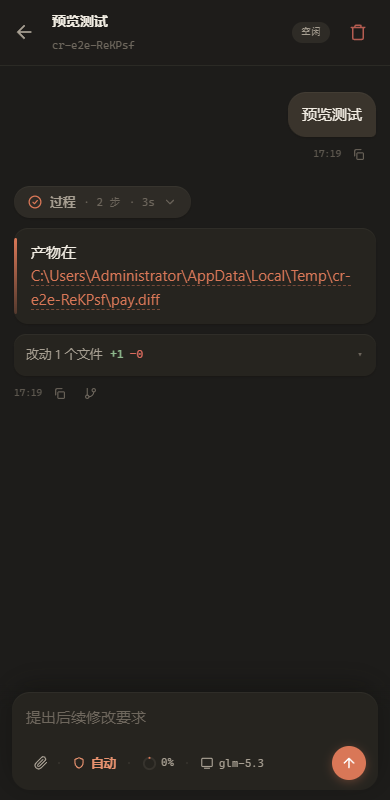
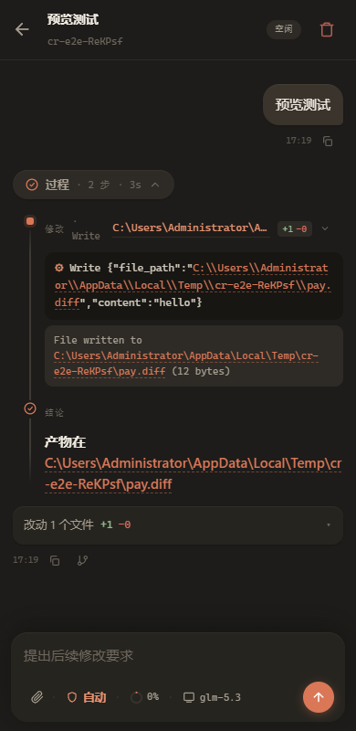
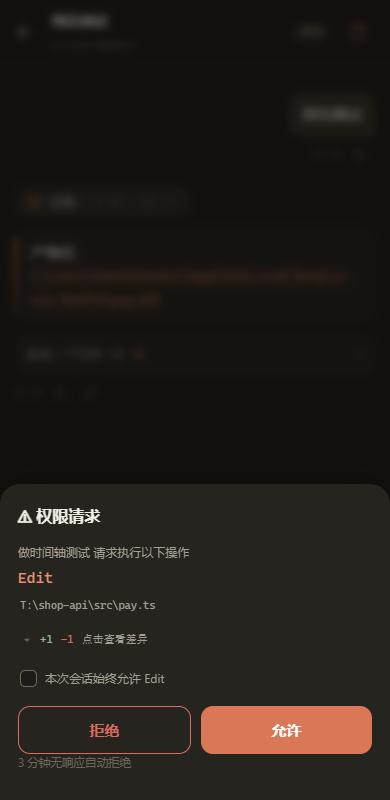
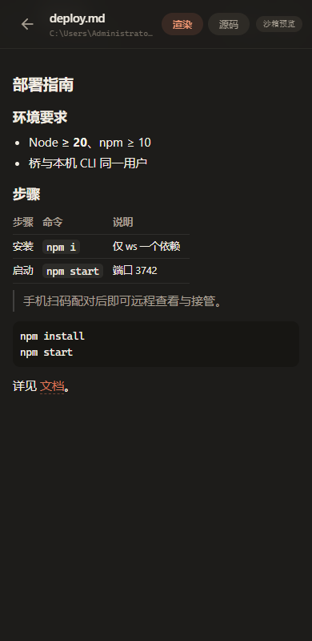
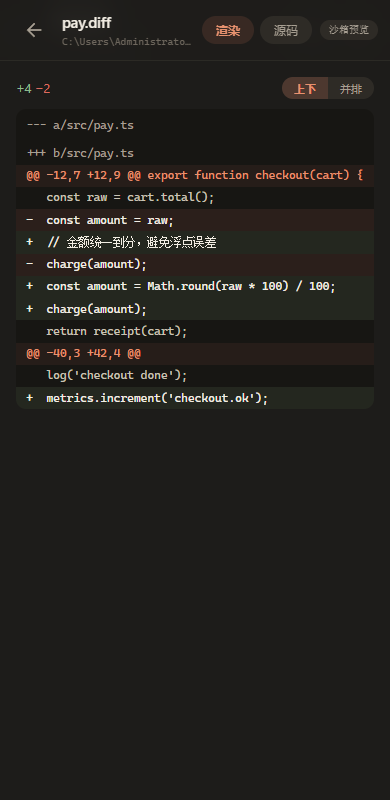
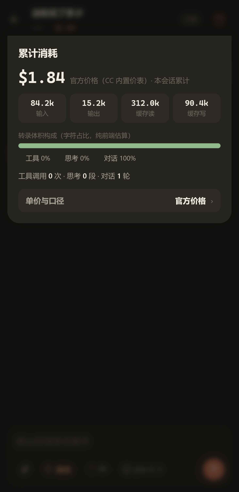
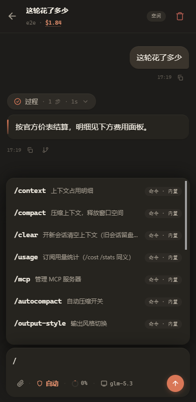
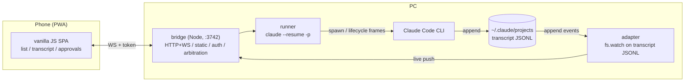
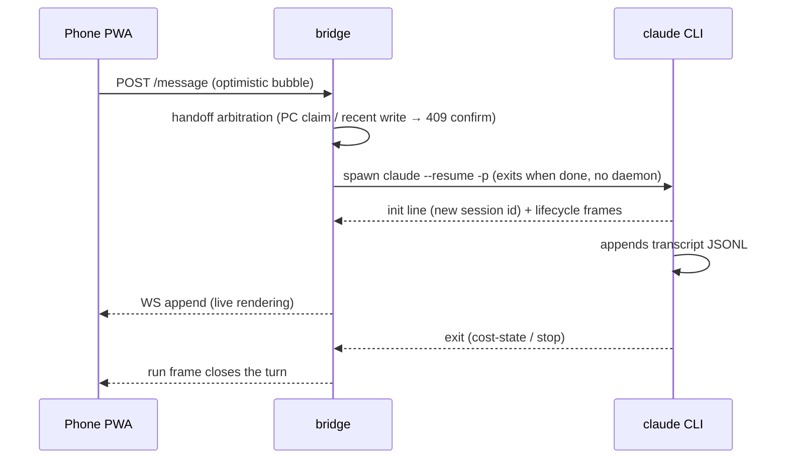

# claude-web

**View and drive your local Claude Code sessions from the phone — LAN bridge + zero-build PWA, single `ws` dependency.**

<p>
  <br>
  <br>
  
</p>

> **Disclaimer**: This is an **unofficial** personal-use project. It is not affiliated with or endorsed by Anthropic PBC or any Claude brand owner. Released under a [non-commercial license](LICENSE) — personal/study use allowed, redistribution must credit the source, **commercial use prohibited**. Use at your own risk.
>
> **Security**: this tool exposes a "can run arbitrary commands" Claude Code to a web page on your LAN. Only use it on trusted networks (home LAN / Tailscale); never port-forward it to the internet. See [SECURITY.md](SECURITY.md) (Chinese).

**Form factor**: mobile-first (phone browser / add-to-home-screen PWA). The desktop browser works fully, but layout and interactions are designed for the phone; desktop niceties may come later.

## Why claude-web

- **The whole link stays on your LAN** — no cloud relay, no third-party account; the token lives on your own machine, and the entire stack is a single Node process.
- **Sessions are files, coexisting with the official clients** — the bridge reads and appends the same transcript JSONL the official CLI and desktop app use: a session started from the phone is right there when you reopen the desktop app. Nothing is wrapped, copied, or sandboxed.
- **No resident agents, arbitration by design** — each message spawns one `claude --resume -p` that exits when done, leaving no background agent behind; sends pass handoff arbitration (recent-write detection + PC claim locks), so multiple clients never fight over a session.
- **Minimal and auditable** — a single runtime dependency (`ws`); the frontend is zero-build vanilla JS with no bundler, framework, or toolchain — you can read the whole codebase in an afternoon.
- **Phone-first to the core** — optimistic bubbles, a message queue, approval cards with ±diff, folded live transcripts; the one-handed browsing experience is deliberately polished.

## Quick start

```bash
git clone https://github.com/SpinCheng/Claude-Web-X.git claude-web
cd claude-web
npm install
npm start          # node bridge/index.js, port 3742
```

1. Open **http://localhost:3742/pair** on the PC (localhost-only) → pairing QR code
2. Scan it from a phone on the same Wi-Fi → paired, permanent
3. Optionally install autostart from the pair page (Windows only)

Linux/macOS: same commands (hooks use `bridge/hook-post.sh`). Two verified pitfalls: the CLI refuses `--dangerously-skip-permissions` under root/sudo — use a normal user; write `~/.claude/settings.json` (with your relay credentials in the `env` block) **before** starting the bridge.

Requires a working Claude Code CLI (any distribution — npm global or the copy bundled with a desktop client; auto-discovered). Documentation is Chinese-first; an auto-translated read is usually enough for the code, which has English comments throughout.

## Architecture & message flow





Sessions are files: desktop, terminal and phone all write the same transcripts; the bridge only does non-resident resumes (`--resume <id> -p`), so it never fights the desktop app. PC-side takeover lives in `cli/cr.mjs` (`node cli/cr.mjs list | attach | release | url`, cross-platform).

## Features

- Project-grouped session list with status lamps, search, batch manage, rename (native `custom-title` records), trash-safe delete
- Live transcript: folded thinking/tool calls, pinned conclusions, streaming follow; gesture-revealed history pagination
- Continue a session or start a task (pick a working dir); per-message permission mode (auto / phone approval cards with Edit ±diff and session-level always-allow), model and reasoning effort
- Context ring (Desktop-parity accounting via CLI `/context` probe); cost panel (official / multiplier / custom per-model rates)
- Attachments (compressed images, inlined text), artifact preview (locked to the project dir, XSS-hardened; html and md both get a sandboxed render + source dual tab), Markdown export, per-turn changed-files rollup, in-session fork
- Message queue (edit/reorder/jump), optimistic bubbles (breathing dot → confirmed, red on stop)

## Directory layout

```
claude-web/
├── README.md / README.en.md / SECURITY.md / CONTRIBUTING.md / LICENSE
├── CLAUDE.md                   # engineering facts & conventions
├── package.json                # single runtime dep (ws), Node >= 20 ESM
├── bridge/                     # daemon: HTTP+WS + static + auth
│   ├── index.js / server.js    # entry / composition root (routes, static, probe)
│   ├── lib/                    # router / wshub / auth / mime / models / platform (OS specifics)
│   ├── routes/                 # sessions / message / attachments / hooks / approvals / pairing
│   ├── parsers-cc.js           # transcript-line judgments (pure, unit-tested)
│   ├── adapter-cc.js           # fs.watch on ~/.claude/projects transcripts
│   ├── runner.js               # non-resident executor (one resume -p per message)
│   └── handoff.js / ctxprobe.js / store.js / hooks.js / approve-mcp.mjs / hook-post.{cmd,sh}
├── public/                     # PWA (zero-build vanilla JS) + pair.html + vendor(qrcode, MIT)
├── cli/cr.mjs                  # PC-side takeover (cross-platform)
├── scripts/                    # start-bridge.vbs / rotate-token.ps1 / make-icons.mjs / shots.mjs
├── test/                       # unit (73) + e2e (isolated bridge + headless Edge, 13 scenarios)
└── docs/screenshots/
```

## FAQ

**Q: the model says it has no Bash/command-execution tool in a phone session, but git/bash clearly work on my PC?**

Claude Code's Bash tool on Windows depends on *discovering Git Bash* (standard locations + the process PATH); if it is not found, the tool is not registered at all. Environment variables are a snapshot taken at process birth: a bridge started from a lean context (autostart, script chain) can lose the Git directories. This project's runner has a built-in fallback (probes common install locations and prepends them to the child PATH). If that still misses, add Git to the system PATH, or restart the bridge once from a full terminal.

## Requirements

| Component | Verified | Notes |
|---|---|---|
| OS | Windows 11; Linux x64 (RHEL-family tested) | OS specifics isolated in `bridge/lib/platform.js` |
| Node.js | ≥ 20 (tested 22.x) | ESM, `fs.watch(recursive)`, polling fallback |
| Claude Code CLI | 2.1.308 (Win) / 2.1.197 (Linux) | any distribution, auto-discovered |

The bridge consumes CLI behavior and data formats directly (transcript JSONL shape, flag names, hook payloads), so it is **tightly coupled to the CLI version** — pin `claudePath` in `bridge/data/config.json` if an upgrade breaks things.

## Notes

- `.ps1` files must stay pure ASCII (PS 5.1 parses as GBK); JS/MD have no such limit
- Secrets/tokens are never logged; `bridge/data/` is gitignored
- Static serving is limited to `public/`; the pair panel is localhost-only
- `public/brand-mark.png` is the official Claude client tray template (pure alpha; tinted via CSS mask; the P badge marks this as unofficial)

## License

[Non-commercial license](LICENSE) (Chinese authoritative, English translation inside): personal and study use allowed; redistribution must credit the source; **commercial use prohibited**. Contains vendored qrcode-generator@1.4.4 under its original MIT license. Contributing means accepting these terms.
