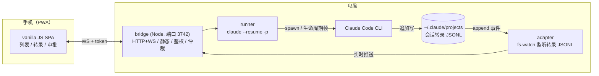
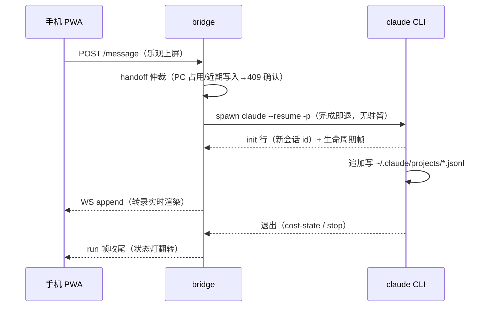

# claude-web

**用手机（PWA）远程查看并操控本机 Claude Code 会话 —— 局域网 bridge + 免构建 PWA，单 `ws` 依赖。**

<p>
  <br>
  <br>
  
</p>

> **免责声明**：本项目是为方便个人使用而开发的**非官方**作品，与 Anthropic PBC 及任何 Claude 品牌方无关联、未获其背书；Claude 及相关商标归其各自所有者。
> 项目按[非商业许可](LICENSE)发布——个人学习研究可用、转载须注明出处、**禁止商用**。风险自担。
>
> **安全提醒**：这个工具把「能执行任意命令的 Claude Code」暴露给局域网网页。只在可信网络（家庭局域网 / Tailscale）使用，不要端口映射到公网。详见 [SECURITY.md](SECURITY.md)。

**产品定位**：主要面向**移动端**（手机浏览器 / 添加到主屏幕的 PWA）。PC 端浏览器可正常使用全部功能，但布局与交互以手机为第一优先设计，桌面体验后续视情况补充。

## 为什么是 claude-web

- **链路完全在局域网内**——没有云端中转、没有第三方账号；token 只存在你自己的机器上，全部流量就是本机一个 Node 进程。
- **会话即文件，与官方客户端无缝共存**——直接读写官方 CLI / 桌面端使用的同一份转录 JSONL：手机上开的会话，桌面端重开即见；不接管、不复制、不另建沙盒。
- **无驻留、可仲裁**——每条消息只 spawn 一次 `claude --resume -p`，跑完即退，不留后台 agent；发送前经 handoff 仲裁（近期写入检测 + PC 接管锁），多个客户端同时用也不会打架。
- **极简、可审计**——后端运行时依赖只有 `ws` 一个；前端是免构建 vanilla JS，无打包器、无框架、无工具链，一个下午能读完全部源码。
- **为手机而生**——乐观上屏、消息队列、带 ±diff 的审批卡、折叠式实时转录，单手刷会话的交互细节都打磨过。

## 快速开始

```powershell
git clone https://github.com/SpinCheng/Claude-Web-X.git claude-web
cd claude-web
npm install
npm start          # node bridge/index.js，端口 3742
```

1. 电脑浏览器打开 **http://localhost:3742/pair**（仅本机可访问）→ 页面显示配对二维码
2. 手机（连同一 Wi-Fi）扫码 → 自动配对并进入会话列表，之后永久有效
3. 在 pair 页点 **安装开机自启**（仅 Windows），登录后 bridge 自动后台运行（双开保护）

Linux / macOS：`npm install && npm start` 同样适用（hooks 走 `bridge/hook-post.sh`）。
两个实测坑：**CLI 拒绝 root/sudo** 跑跳过权限模式——用普通用户；**先写好 `~/.claude/settings.json` 再起桥**（env 块缺失会被缓存锁死）。

前提：本机装有可用的 Claude Code CLI 并完成登录（第三方客户端内置的 CLI 亦可，runner 自动发现）；API 凭证按你环境的惯例放在 `~/.claude/settings.json` 的 `env` 块，spawn 时由 bridge 显式注入子进程。

## 架构与消息流





会话即文件：CLI 桌面端、终端、手机端写的都是同一份转录文件，bridge 只做无驻留恢复（`--resume <id> -p`），与桌面端零冲突；PC 终端接管用 `node cli/cr.mjs`（list / attach / release / url，跨平台）。

## 能做什么

- 会话列表按项目分组，状态灯（运行中/失败/已停止/完成）、搜索、批量管理、重命名（写原生 `custom-title`，桌面端同款）、删除（回收站可找回）
- 实时转录：思考/工具调用折叠、结论常显、流式跟随滚动；历史分页加载（跟手渐显的加载行）
- 直接续聊 / 新建任务（选工作目录）；发送可带权限模式（自动 / 手机逐条审批，审批卡含 Edit±diff 与会话级 always-allow）、模型与推理等级
- 底部上下文圆环（与桌面端同口径，CLI `/context` 实测）；费用面板（官方口径 / 倍率 / 自定义单价，分模型计账）
- 附件（图片压缩直传 / 文本内联）、产物预览（锁项目目录内、防 XSS 白名单；html 与 md 均有沙箱渲染 + 源码双 tab）、导出 Markdown、改动文件 ± 汇总、会话内分支（fork）
- 排队消息（增删/重排/插队）、乐观上屏（呼吸灯→落盘转实，停止转红）

## 目录结构

```
claude-web/
├── README.md / README.en.md / SECURITY.md / CONTRIBUTING.md / LICENSE
├── CLAUDE.md                   # 工程事实与约定全集（机器无关部分；本机细节在 LOCAL.md，不入库）
├── package.json                # 仅 ws 一个运行时依赖，Node ≥ 20 ESM
├── bridge/                     # 常驻 daemon（HTTP+WS+静态+鉴权）
│   ├── index.js / server.js    # 入口（配置迁移/事件接线/双开保护）/ 组装根（路由+静态+探针）
│   ├── lib/                    # router / wshub(WS枢纽+审批) / auth / mime / models / platform(OS 差异单点)
│   ├── routes/                 # sessions / message / attachments / hooks / approvals / pairing
│   ├── parsers-cc.js           # 转录 JSONL 行判定纯函数（单测覆盖）
│   ├── adapter-cc.js           # ~/.claude/projects 监听解析（状态推导、回收站、上下文记账）
│   ├── runner.js               # 无驻留执行器（每条消息一次 resume -p；排队；模型/等级；权限路由）
│   ├── handoff.js / ctxprobe.js / tailer.js / store.js / hooks.js / approve-mcp.mjs / hook-post.{cmd,sh}
├── public/                     # PWA（免构建 vanilla JS）：index.html / app.js / js/ / style.css / pair.html / vendor(qrcode, MIT)
├── cli/cr.mjs                  # 电脑端接管工具（跨平台）list/attach/release/url
├── scripts/                    # start-bridge.vbs / rotate-token.ps1 / make-icons.mjs / shots.mjs(截图)
├── test/                       # unit(9 套 73 例) + e2e(隔离桥 :3799 + headless Edge，13 场景)
└── docs/screenshots/           # README 截图（合成数据拍摄）
```

## 运行环境

| 组件 | 实测 | 说明 |
|---|---|---|
| OS | Windows 11；Linux x64（RHEL 兼容系实测） | 跨平台差异集中在 `bridge/lib/platform.js` |
| Node.js | ≥ 20（实测 22.x） | ESM、`fs.watch(recursive)`、降级轮询 |
| Claude Code CLI | 2.1.308（Win）/ 2.1.197（Linux） | npm 全局或第三方客户端内置副本均可（按 mtime 自动发现） |

本工程直接消费 CLI 的行为与数据格式（转录 JSONL 字段、旗标名、hooks 回调），**与 CLI 版本强耦合**——CLI 升级后若异常，可在 `bridge/data/config.json` 设 `claudePath` 钉住版本。

## 注意

- Windows 下写 `.ps1` 必须纯 ASCII（PS 5.1 按 GBK 解析）；JS/MD 无此限制
- 密钥/token 永不写日志；`bridge/data/`（config、锁、回收站、探针缓存）已 gitignore
- 静态服务只允许 `public/`；配对面板仅同机访问
- `public/brand-mark.png` 为 Claude 官方客户端托盘模板图（纯 alpha，PWA 以 CSS mask 按主题着色；P 徽章为非官方区分标注）

## 常见问题（Q&A）

**Q：手机会话里 AI 说「没有 Bash/命令执行工具」，但我电脑上 git / bash 明明都能用？**

Claude Code 的 Bash 工具在 Windows 上依赖**发现 Git Bash**（标准位置 + 进程 PATH），找不到就整个工具不注册。
环境变量是进程出生时的快照：bridge 从精简上下文启动（开机自启、脚本链）时可能丢 Git 目录。
本工程 runner 已内置兜底（spawn 时探测常见安装位置并前置 PATH）；仍中招就把 Git 目录加进系统 PATH，或在完整终端里重启一次 bridge。

## License

[非商业许可](LICENSE)：个人学习研究可用、转载须注明出处、**禁止商用**（内含 vendored 的 qrcode-generator@1.4.4，按其原 MIT 许可）。
贡献即表示接受本许可条款。
