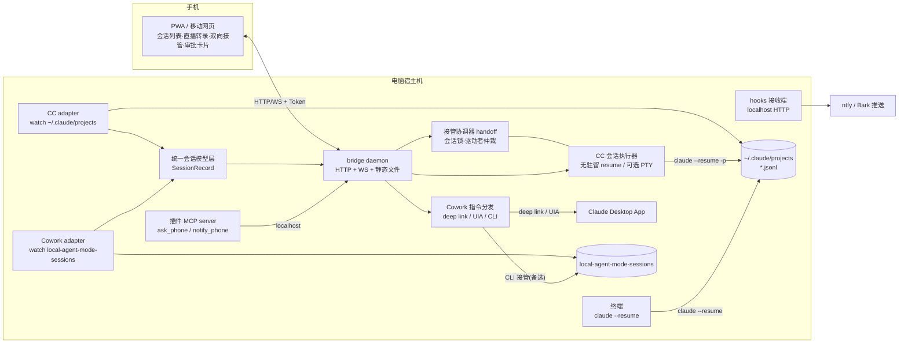

# Claude Desktop 手机远程操控插件 · 可行性方案与架构设计

版本：v2（2026-10-24）｜ 目标平台：Windows 11 + Claude Code CLI + Claude Desktop（Cowork / agent 模式）

> v2 变更：① 账号形态为第三方 API 中转，官方 Remote Control 不可用；② 纳入 Claude Code 会话且**优先级高于 Cowork**；③ 按双向接管需求（手机⇄电脑任务互通、任一侧可接管继续聊）重构控制面。
> 本文档为工程架构基准，原始调研出处见文末链接。

## 结论摘要

**方案可行，且比 v1 更顺。** 核心洞察是把"会话"统一看作本地明文转录文件：Claude Code 会话存在 `~/.claude/projects/` 下的 JSONL，Cowork 会话存在 `local-agent-mode-sessions/` 下的状态文件 + 转录。**会话即文件、接管即恢复**——手机与电脑任一侧"接管"就是附加到同一份转录继续写。对 Claude Code 这是纯官方机制（`claude --resume`），稳态、零 Hack，与你"CC 优先"的排序天然吻合；Cowork 的手机侧接管仍需 UI 自动化 / CLI 接管的非官方路线（v1 结论不变）。

双向接管的冲突问题用**无驻留执行模型**化解：手机侧不长期持有会话进程，每条消息触发一次 `claude --resume -p` 流式执行、完成即退——消息之间不存在活进程，电脑随时可在终端 `claude --resume` 接管，天然无冲突。官方 Remote Control 因第三方 API 不可用，从方案中移除，无架构影响（本方案本就全自建）。

**必须诚实标注**：除 deep link、MCP、`claude --resume` 外，读取会话文件与 UI 自动化均为非官方接口，跨版本不保证稳定；且第三方中转客户端可能版本滞后或打过补丁，一切桌面端适配以你实际安装版本实测为准。

## 1. 需求范围（已确认）

| 维度 | 选择 |
|---|---|
| 网络 | 局域网 / Tailscale 组网直连，不自建云中继 |
| 账号形态 | 第三方 API 中转（官方登录体系的功能一律不可用） |
| 覆盖对象 | **Claude Code 会话优先**，Cowork 任务其次 |
| 互通模型 | **双向接管**：手机可接管电脑开的任务续聊；电脑可接管手机发起的任务 |
| 手机端 | PWA / 网页 |
| 使用对象 | 自己用 |

## 2. 官方能力边界（核实结果）

置信度标注：【官方文档】= 文档明示；【待实测】= 机制可行但需动手验证。

| # | 能力 | 结论 | 依据 |
|---|---|---|---|
| 1 | 插件体系 | 插件 = 目录（`.claude-plugin/plugin.json`），可打包 MCP servers、skills、commands、agents、hooks，经 marketplace（含本地 marketplace.json）安装 | 【官方文档】code.claude.com/docs/en/plugins/overview |
| 2 | 插件内 MCP server | 以宿主机当前用户权限子进程运行，可读写用户文件、spawn 其他进程 | 【官方文档】support.claude.com/en/articles/10413127 |
| 3 | MCP server 生命周期 | 无官方文档；按需拉起，有孤儿进程 bug | 【官方 issue】claude-code #1935 → 核心服务必须独立 daemon |
| 4 | hooks 生效范围 | **Claude Code CLI 会话内 hooks 生效**（Stop / Notification / PostToolUse，配在 `~/.claude/settings.json`）；**Cowork agent 模式忽略 hooks** | 【官方文档 + issue】code.claude.com/docs/en/hooks-guide；claude-code #40495、#51904 → CC 用 hooks 推送、Cowork 用轮询 |
| 5 | CC 会话存储 | `%USERPROFILE%\.claude\projects\<工作区slug>\<sessionId>.jsonl`，明文追加式 JSONL；终端、IDE 插件、任何方式启动的 CC 会话都落在这里 | 【官方文档】code.claude.com/docs/en/sessions |
| 6 | `claude --resume` | 官方操作：按 sessionId 恢复任意本地会话（交互模式或 `-p` 无头模式，`--output-format stream-json` 流式输出）——**双向接管的技术基石** | 【官方文档】code.claude.com/docs/en/sessions、/cli-reference |
| 7 | Agent SDK 权限回调 | `canUseTool` 回调把每次工具调用的批准权交给宿主程序 → 可转成手机审批 UI | 【官方文档】Agent SDK 文档 |
| 8 | Cowork 会话存储 | `%LOCALAPPDATA%\Claude-3p\local-agent-mode-sessions\<账户>\<org>\<sessionId>\`：`local_<uuid>.json` 状态文件 + 工作目录（transcript、`uploads/`、`outputs/`）+ `audit.jsonl`（HMAC 签名） | 【官方文档】claude.com/docs/third-party/claude-desktop/data-storage |
| 9 | 桌面端⇄CLI 会话互通 | 官方支持桌面 App 恢复 CLI 会话；反方向 CLI 接管 Cowork 会话机制可能、无保证 | 【待实测】code.claude.com/docs/en/sessions |
| 10 | Deep links | `claude://cowork/new?q=<文本>` 新建 Cowork 任务；`claude://claude.ai/chat/<id>` 打开已有会话；`claude://code/new?q=` 新建 CC 会话——本地机制，第三方中转客户端**需实测**是否支持 | 【官方文档】support.claude.com/en/articles/14729294-open-claude-desktop-with-a-link |
| 11 | 官方 Remote Control | 只覆盖官方账号的本机 Claude Code 会话；**第三方 API 场景不可用**，从方案移除 | 【官方文档】code.claude.com/docs/en/remote-control |
| 12 | 向已有会话注入消息的 API | Cowork：不存在官方途径；CC：`--resume` 即官方注入途径 | → Cowork 手机侧注入只能 UI 自动化或 #9 |

## 3. 与现有方案对比

| 方案 | 控制对象 | 对你可用 | 备注 |
|---|---|---|---|
| 官方 Remote Control | 本机 CC 会话 | ❌ 需官方账号 | 移除 |
| Claude Code on the web | Anthropic 云沙箱 | ❌ 同上 | 移除 |
| Happy / Omnara / Vibe Kanban | 本机 CC 会话 | ⚠️ 部分 | Happy 的手机↔本地 CC 体验与本方案 CC 半边高度重合，但其同步走 Happy 云端；你要求 LAN 直连，且其不含 Cowork。开源，**协议与交互设计值得借鉴** |
| **本方案（自研插件）** | CC + Cowork | ✅ | 唯一同时覆盖两者且全本地的路径 |

## 4. 总体架构



组件职责：

**Bridge daemon（常驻核心）**：HTTP/WS 服务 + PWA 静态托管 + token 鉴权。

**统一会话模型层**：两个 adapter 把各自数据源归一为 `SessionRecord { id, kind: cc|cowork, title, status, transcriptPath, lastActive, driver }`。PWA 不感知来源差异，只按 kind 标注能力等级（cc = 官方接管，cowork = 非官方接管）。

**CC 会话执行器**：无驻留模型（默认）——手机每条消息执行一次 `claude --resume <id> -p "<msg>" --output-format stream-json`，流式转发到 PWA，结束即退；可选 PTY 常驻模式（node-pty 持有交互进程）换取实时键盘级操作（发送 Esc / Ctrl-C 中断），代价是进程与 bridge 同生共死。

**接管协调器**：双向接管的核心。每会话一个 advisory 锁文件 + 转录 mtime 活跃检测，维护"当前驱动者"状态（电脑终端 / 手机 / 空闲），接管动作前先仲裁（详见第 7 节）。

**hooks 接收端**：CC 的 Stop / Notification hooks 向 `localhost:<port>/hooks` 发 POST → 立即推手机。CC 侧通知零轮询、低延迟；Cowork 侧维持监视器轮询。

**插件 MCP server**：拉起时确保 daemon 存活；向会话暴露 `ask_phone` / `notify_phone`。

关键设计决策：

- **D1 · bridge 独立 daemon**：MCP server 生命周期无保证，只当安装器 + 工具面板。
- **D2 · 会话即文件、接管即恢复**：不复制、不同步会话状态，手机和电脑读写同一份转录文件，天然一致。
- **D3 · CC 无驻留执行**：消息之间没有活进程，电脑接管零冲突；这是双向互通能做简单的关键取舍。
- **D4 · 单驱动者仲裁**：同一会话同一时刻只允许一个驱动者写入，切换需显式接管（防 JSONL 交错双写）。

## 5. 数据面设计（看到所有任务）

**双数据源统一监听**：CC adapter 用 chokidar 监听 `~/.claude/projects/**/*.jsonl`（终端、IDE 插件、bridge 发起的会话全部落于此，天然全覆盖）；Cowork adapter 监听 `local-agent-mode-sessions`。会话列表 CC 分组置顶、Cowork 其后。

**实时转录**：两个来源都是追加式 JSONL，统一走"增量 tail → 解析 → WS 推送"管道，解析规则按 kind 分开（Phase 0 各自固化字段）。PWA 渲染：Markdown 正文、工具调用折叠卡、文件产物预览。

**状态判定与通知**：CC——hooks 直接推（完成/需注意），辅以转录 mtime 兜底；Cowork——轮询状态机。推送通道 ntfy（可自建）/ Bark，正文只带标题与状态。

**产物文件服务**：只读静态映射 CC 工作区与 Cowork 的 `outputs/` `uploads/`（防路径穿越）。

## 6. 控制面设计

### 6.1 Claude Code（优先，全官方机制）

新任务：手机发起 → bridge 执行 `claude -p "<任务>" --output-format stream-json`（新 sessionId 由执行器捕获并回填关联），或 PTY 模式交互式起会话。

手机续聊电脑开的会话：无驻留 resume——每条消息一次 `claude --resume <id> -p ...`。会话空闲时这是官方操作、完全干净；若电脑终端正持有该会话交互中，接管协调器给出选项：等待空闲 / 强制（转入注入）。

电脑接管手机发起的会话：手机发起的任务以标准 JSONL 落在 `~/.claude/projects`，电脑终端 `claude --resume <id>` 即接管。提供 `cr` 小工具：`cr list` 与 `cr attach <序号>`；PWA 上"转到电脑"按钮也可直接唤起终端执行。

手机对电脑终端**进行中**会话的实时注入（可选能力）：复用 Cowork 的 UIA 管道，目标改为终端窗口；日常续聊走 resume 即可。

中断与审批：PTY 模式手机可发 Esc / Ctrl-C 原生中断；权限控制 MVP 用 `--permission-mode` + allowlist 配置，进阶把执行器换成 Agent SDK（`canUseTool` 回调 → PWA 审批卡片 → 返回决定）。

### 6.2 Cowork（非官方路线）

新建任务走 `claude://cowork/new?q=`（官方 deep link + watcher 关联捕获新会话）；手机注入进行中会话走 UIA 主路线（唤起会话 → 剪贴板粘贴 → 模拟发送，兼可点击权限弹窗 Allow）；CLI 接管（读 `cliSessionId` 后 `claude --resume`）作为备选并保留全部【待实测】警示（沙箱环境不一致、双写风险）。电脑接管手机发起的 Cowork 任务天然成立——deep link 创建的就是 App 内原生会话。

### 6.3 会话主动呼手机（官方表面，双 kind 通用）

插件 MCP server 的 `ask_phone` / `notify_phone` 工具，新任务提示词模板声明后即获得原生手机审批体验。

## 7. 双向接管与冲突规则（互通模型核心）

| 发起方 ↓ / 接管方 → | 电脑接管 | 手机接管 |
|---|---|---|
| **手机发起 · CC** | `claude --resume` / `cr attach`，官方机制，随时可接管（无驻留模型保证零冲突） | — （本来就是手机驱动） |
| **电脑发起 · CC** | — | 空闲时 resume（官方、干净）；进行中可选终端 UIA 注入 |
| **手机发起 · Cowork** | App 内点开即接管（deep link 创建的即原生会话） | — |
| **电脑发起 · Cowork** | — | UIA 注入主路线 / CLI 接管备选（非官方，待实测） |

并发规则：每会话一个 advisory 锁文件（`<sessionId>.lock`，内容为驱动者标识与心跳时间）；写入方在接管前由协调器仲裁（电脑终端 claude 进程无法主动加锁，故以转录 mtime 活跃检测 + 用户确认为准）——PWA 与 `cr` 工具都显示"当前驱动者"，切换需确认。最坏情形（两侧同时写同一 JSONL）因追加式结构不会损坏文件，但历史会交错，规则目标是避免而非兜底。

## 8. 网络与安全

token 鉴权、绑定局域网、Tailscale HTTPS（推荐，兼得外网）、白名单化指令、推送不带正文、路径穿越防护。增补：bridge spawn 的 claude 进程继承第三方 API 环境变量（`ANTHROPIC_BASE_URL` / `ANTHROPIC_AUTH_TOKEN`），**密钥不得写入任何日志或推送到手机**；UI 自动化与 deep link 的适配以实际安装的客户端版本为准。

## 9. 插件打包与项目结构

```
claude-remote/
├── .claude-plugin/plugin.json     # 清单：mcpServers（+ 可选 hooks 示例）
├── marketplace.json               # 本地 marketplace
├── mcp/server.js                  # ask_phone / notify_phone / bridge_status
├── bridge/
│   ├── server.js                  # HTTP + WS + 静态服务
│   ├── sessions/                  # 统一会话模型层
│   │   ├── adapter-cc.js          #   ~/.claude/projects 监听与解析
│   │   └── adapter-cowork.js      #   local-agent-mode-sessions 监听与解析
│   ├── runner.js                  # CC 无驻留执行器 / PTY 模式
│   ├── handoff.js                 # 接管协调器（锁 + 仲裁 + cr 数据源）
│   ├── dispatcher-cowork.js       # Cowork deep link / UIA / CLI 分发
│   └── hooks-receiver.js          # CC hooks → 推送
├── pwa/                           # Vue3 + Vite（构建产物由 bridge 服务）
├── cli/cr.ps1 / cr.cmd            # 电脑接管小工具（list / attach）
└── scripts/                       # install-daemon / uia-send / inspect
```

## 10. 技术选型

Node 20+ / TypeScript；`@modelcontextprotocol/sdk`；（进阶）`@anthropic-ai/claude-agent-sdk`（canUseTool 审批）；node-pty（可选实时模式）；fastify + ws；chokidar；Vue 3 + Vite + Pinia + marked/DOMPurify；ntfy / Bark；PowerShell UIA。

## 11. 风险清单

| 风险 | 等级 | 缓解 |
|---|---|---|
| 会话文件格式随版本变动（无契约） | 高 | 双 adapter 隔离 + 启动自检 + 降级为仅列表 |
| **第三方中转客户端版本滞后/打过补丁** | 高 | deep link、UIA、目录结构全部按实机 Phase 0 校准；适配层参数化 |
| UI 自动化随 UI 改版失效 | 高（必然，可修） | 选择器集中配置 + 勘探脚本；自动降级提示 |
| 两侧同时写同一会话（双写交错） | 中 | 单驱动者仲裁 + 锁 + mtime 活跃检测 |
| CLI 接管 Cowork 会话的沙箱差异 / 双写 | 中 | 仅对空闲会话启用；Phase 0 实测划界 |
| CC hooks 配置误伤本地工作流 | 低 | hooks 只 POST 到 localhost，失败静默 |
| MCP server 生命周期不定 | 中 | bridge 独立 daemon + 开机自启 |
| token 泄露 / API 密钥落日志 | 中 | 环境变量注入子进程；日志脱敏；一键轮换 |
| App 更新清理 Cowork 历史（issue #48334） | 中 | watcher 快照备份 |

## 12. 分阶段路线图（CC 优先重排）

**Phase 0 · 实地验证（半天～1 天，动工前必做）**：见工程 `phase0/` 目录（六项脚本化）。

**Phase 1 · CC 只读 + 通知（2～3 天）**：CC adapter + PWA 列表/直播/文件预览 + hooks 推送。

**Phase 2 · CC 全双工 + 双向接管（3～4 天）**：无驻留执行器、接管协调器、`cr` 工具、任务关联捕获；进阶可选 Agent SDK 审批。

**Phase 3 · Cowork 数据面（1～2 天）**：Cowork adapter 接入统一模型。

**Phase 4 · Cowork 控制 + 打磨（3～5 天）**：deep link 下发、UIA 注入与远程 Allow、Tailscale HTTPS / PWA 安装、二维码配对、备份。

## 13. 参考链接

Plugins：https://code.claude.com/docs/en/plugins/overview 、https://code.claude.com/docs/en/plugins/manifest-reference ；插件 MCP server 权限：https://support.claude.com/en/articles/10413127 ；会话与 resume：https://code.claude.com/docs/en/sessions ；hooks：https://code.claude.com/docs/en/hooks-guide ；Cowork 数据存储：https://claude.com/docs/third-party/claude-desktop/data-storage ；Deep links：https://support.claude.com/en/articles/14729294-open-claude-desktop-with-a-link ；Remote Control（本方案不可用，存档）：https://code.claude.com/docs/en/remote-control ；Cowork 内部机制逆向（第三方）：https://pluto.security/blog/inside-claude-cowork-how-anthropics-autonomous-agent-actually-works ；Cowork hooks 失效 issue：https://github.com/anthropics/claude-code/issues/40495 、https://github.com/anthropics/claude-code/issues/51904 ；同类工具（CC 半边参考）：https://happy.engineering 、https://github.com/BloopAI/vibe-kanban 。
